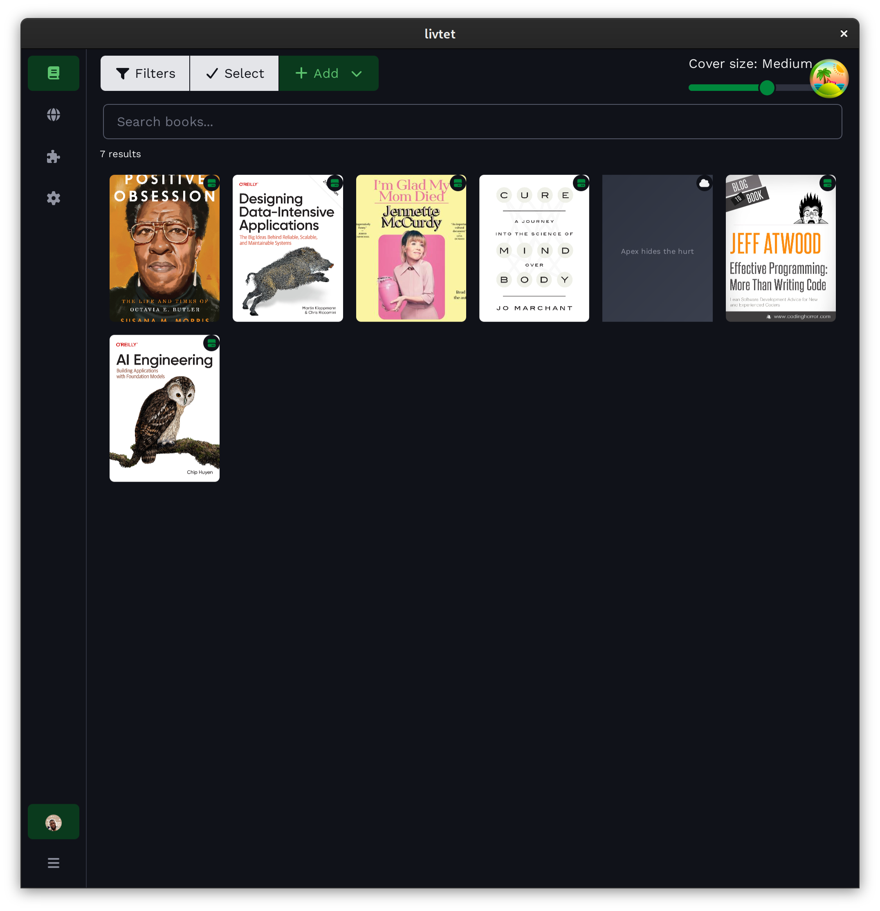

# Livtet for Desktop

[](https://github.com/olamaelcu/livtet-desktop/actions/workflows/ci.yml)

Search, browse, and manage a personal library of books. Livtet indexes local
and remote catalogues, fetches cover art and edition details, and surfaces
metadata through a fast command palette. The frontend is SvelteKit with
[WebAwesome](https://webawesome.com/) custom elements and the Livtet brand
identity — Work Sans, Lora, and JetBrains Mono, themed from the
[livtet-branding](https://github.com/olamaelcu/livtet-branding) design tokens.
The shell is Rust, talking to the webview through Tauri IPC.

## Stack

- [Tauri](https://tauri.app/) 2 with `tauri-plugin-opener`, `tauri-plugin-decorum` (overlay
  titlebar), and `tauri-plugin-mcp-bridge` in dev
- [SvelteKit](https://svelte.dev/docs/kit/) 2 + [Svelte 5](https://svelte.dev/), bundled by Vite 8, source under `web/`
- [WebAwesome](https://webawesome.com/) 3.x components, loaded via the auto-loader
- Livtet brand theme via `@olamaelcu/livtet-branding` (git dependency), imported
  as CSS in `web/app.css` after Web Awesome's default theme: generated tokens
  (brand/neutral/semantic ramps, surfaces, text) plus the "Modern Card Catalog"
  component theme, both in cascade layers so load order decides and nothing needs
  `!important`. Fonts come from [Fontsource](https://fontsource.org/): Work Sans
  (body), Lora Variable (heading), JetBrains Mono (code)
- [Rust](https://www.rust-lang.org/) 1.85+, edition 2021, single workspace member in `tauri/`



## Quick start

```sh
pnpm install
pnpm tauri:dev
```

See [GETTING_STARTED.md](./GETTING_STARTED.md) for prerequisites, the full dev
loop, and how to produce a release build.

## Install

### macOS (Homebrew)

```sh
brew tap olamaelcu/homebrew-tap
brew install --cask livtet
```

### Debian / Ubuntu (signed APT repository)

```sh
curl -fsSL https://download.livtet.olamaelcu.net/apt/livtet.asc \
  | sudo tee /usr/share/keyrings/livtet.asc >/dev/null
echo "deb [signed-by=/usr/share/keyrings/livtet.asc] https://download.livtet.olamaelcu.net/apt stable main" \
  | sudo tee /etc/apt/sources.list.d/livtet.list
sudo apt update
sudo apt install livtet-desktop
```

### Flatpak

```sh
flatpak remote-add --if-not-exists flathub https://flathub.org/repo/flathub.flatpakrepo
flatpak remote-add --if-not-exists --from livtet https://download.livtet.olamaelcu.net/flatpak/livtet.flatpakrepo
flatpak install livtet net.olamaelcu.livtet
```

Direct downloads (`.deb`, `.rpm`, AppImage, `.dmg`, `.flatpak`) and checksums are on the [releases page](https://github.com/olamaelcu/livtet-desktop/releases).

## Releasing

```sh
node scripts/set-version.mjs 0.2.0
git commit -am "chore: release v0.2.0"
git tag -a v0.2.0 -m "livtet 0.2.0"
git push github main --follow-tags
```

The tag must match `crates/livtet-desktop/tauri.conf.json`; the workflow rejects mismatches.

## Contributing

Bug reports, fixes, and feature work all flow through pull requests. Read
[CONTRIBUTING.md](./CONTRIBUTING.md) for commit conventions, code style, and
the review process.

## License

MPL-2.0. See [LICENSE](./LICENSE). Copyright (c) 2026 Jacky Alcine <yo@jacky.wtf>.
